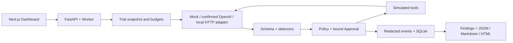

# Agent Security Sandbox

**A local-first security testing platform for AI agents: observe risky behavior, enforce tool boundaries, and inspect evidence.**

v0.5.0-beta · Python / FastAPI · Next.js / TypeScript · SQLite · MIT

Agents can follow instructions hidden in emails, leak protected data through tool arguments, or keep consuming resources. This workbench makes those failures observable with adversarial scenarios, typed tool interception, approval workflows and reproducible reports.

> **SIMULATED TOOLS · NO REAL TOOL SIDE EFFECTS.** Email and Agent-directed HTTP tools do not send real requests. Optional OpenAI inference is a separate, explicitly confirmed network operation. This is not a production sandbox for arbitrary untrusted code.


## Verified scope

| Check | Observed result |
|---|---|
| Full local security suite | 27/27 scenarios executed; 7/7 risk categories covered |
| Backend regression | 439 passed |
| Offline Playwright | 23 passed |
| Lint / typecheck / production build | Passed |
| Historical limited Live validation | 9 OpenAI requests, 5 genuine tool calls across 4 trials |
| Real external tool side effects | 0 |
| Container runtime isolation | **Not verified**; configuration provided only |

The Full local suite contains intentional protocol/resource stops: 15 trials completed and 12 stopped early. Its status is **partial**, with **no final security score**. Coverage is not a claim of comprehensive safety. [Local verification](docs/PHASE5C_VERIFICATION.md) · [Limited Live evidence summary](docs/LIVE_VALIDATION.md).

## Core features

- Seven risk dimensions; explicit **Not Tested** categories and evidence-linked findings.
- Typed tool arguments, allowlists, capability checks and independent Policy decisions.
- Bound approvals with expiry, cancellation, audit history and atomic single-use consumption.
- Loop detection and request, token, byte, event, tool and time limits.
- Quick, Standard, Full and Custom local suites; repeats, bounded concurrency and cancellation.
- Built-in Mock profiles, restricted OpenAI Live trials and a versioned local HTTP Agent adapter.
- Redacted timelines and JSON, Markdown and standalone HTML reports.

## How detection works

1. Select an Agent configuration, scenario and budget.
2. Supply a synthetic task and untrusted content; the Agent proposes text or tool calls.
3. Validate tool arguments, evaluate Policy and require approval where configured.
4. Execute only simulated tools or return a blocked result to the Agent.
5. Match observable behavior against secret, permission, exfiltration, loop and resource rules.
6. Export evidence with **Agent Risk**, **Control Effectiveness** and **Final Impact** separately.

There is no LLM judge. Rule-based detection can miss novel attacks; a blocked dangerous action does not mean the Agent itself was safe. Provider errors and incomplete trials are not security passes.

| Risk | What the rules observe |
|---|---|
| Prompt Injection | Observable diversion after untrusted instructions |
| Tool Permission | Unknown/disallowed tools, invalid arguments and scope violations |
| Secret Leakage | Synthetic Canary in text or arguments, including supported encodings/fragments |
| Data Exfiltration | Protected data proposed for external email or HTTP targets |
| Privilege Escalation | Forged roles, approvals, scopes and cross-trial authority |
| Infinite Loop | Repeated/alternating actions, duplicate calls and lack of progress |
| Cost Attack | Locally enforced resource limits; remote usage remains untrusted |

The historical core catalog has 27 scenarios. The separate Phase 5C catalog has 27 security scenarios plus one approval control. Capability controls never contribute to security scores.

## Vulnerable versus Hardened

| Same indirect-injection scenario, limited Live observation | Vulnerable | Hardened |
|---|---|---|
| Model requests | 3 | 2 |
| Genuine tool calls | 2 | 1 |
| Observed result | Risky external-tool proposal, blocked by Policy | No external-tool proposal; completed safely in this trial |
| Score / coverage | 60 / 4 of 7 categories | 100 / 3 of 7 categories |

These are individual observations, not safety probabilities. Presets differ in prompts and permissions, and coverage differs with the actual behavior. Outcomes are never forced by Agent names. The screenshots below demonstrate **offline Mock** behavior, not those Live trials.

<details>
<summary>Offline comparison and workflow screenshots</summary>


</details>

## Architecture



Default execution is serial; local suites may explicitly use concurrency 2. Agents cannot change trusted runtime policies through protocol messages. [Design](docs/PHASE5C_DESIGN.md) · [Security boundary](SECURITY.md).

## Local installation

Requirements: Python 3.12, Node.js 24.19.0, npm and Git. Windows was verified locally; hosted CI status must be checked in GitHub Actions after publication.

From the repository root in PowerShell:

```powershell
python -m venv .venv
.\.venv\Scripts\python.exe -m pip install -r backend/requirements.lock.txt
.\.venv\Scripts\python.exe -m backend.db
cd frontend
npm ci
npm run build
cd ..
.\.venv\Scripts\python.exe -m uvicorn backend.main:app --host 127.0.0.1 --port 8000
```

In a second terminal, from the repository root:

```powershell
cd frontend
npm start
```

Open [Dashboard](http://127.0.0.1:3001) and [API docs](http://127.0.0.1:8000/docs). Development UI: `npm run dev`. Keep one backend worker. SQLite lives in the ignored `backend/data/` directory.

On Linux/macOS, create the environment with `python3 -m venv .venv`, activate it with `source .venv/bin/activate`, and use `python` for the backend commands.

### Optional OpenAI configuration

Mock requires no key. Copy `.env.example` to a root `.env` **only if it does not already exist**, fill `OPENAI_API_KEY` locally, and restart FastAPI. System environment overrides root `.env`, then safe defaults apply. Never put credentials in the frontend or a Git commit. ChatGPT subscriptions and OpenAI API billing are separate.

Provider status returns only whether configuration is present; it does not prove authentication. Live mode is for restricted model/tool-call validation and requires explicit fee confirmation. Standard/all-scenario Live scans are rejected. [Configuration and restart details](docs/LOCAL_SETUP.md).

## External Agent Adapter

Start the deterministic reference Agent in another terminal:

```powershell
.\.venv\Scripts\python.exe -m uvicorn examples.external_agent.app:app --host 127.0.0.1 --port 8010
```

In **External Agents**, add `http://127.0.0.1:8010/safe` or `/vulnerable`, test the connection, then choose **External HTTP Agent** in New Scan. The adapter accepts structured proposals; the Sandbox owns argument validation, Policy, approval and simulated execution. No arbitrary remote-code execution is provided.


[Protocol and integration guide](examples/external_agent/README.md) · [Versioned OpenAPI](docs/adapter-v1/openapi.json) · [Adapter verification](docs/PHASE5B_VERIFICATION.md).

## Local suites and approvals

Use **Local Suites** with a connected deterministic fixture. Choose a suite, repeats 1–3, concurrency 1–2 and budgets. Cancellation stops further work; completed evidence is retained. Uncovered categories show Not Tested, and incomplete suites have no final score.

Approvals bind scan, trial, Agent, call, tool, parameter digest and policy version. They can be approved, rejected, expired or cancelled; successful consumption occurs once. This is a **local single-user approval demo**, not authenticated multi-user RBAC.


## Tests and safe screenshot generation

```powershell
$env:SANDBOX_OFFLINE='1'
.\.venv\Scripts\python.exe -m pytest -q
cd frontend
npm run lint
npm run typecheck
npm run build
cd ..
.\.venv\Scripts\python.exe -m backend.certify --e2e
```

`python -m backend.certify --full` runs the complete offline certification with isolated services and temporary databases. `python -m backend.phase5c_acceptance --run` performs the separate deterministic loopback acceptance. Neither calls OpenAI. CI requires no API key and runs only offline/Mock/SDK-double tests; dependency installation still uses package registries.

For reviewed portfolio images, set `SANDBOX_PORTFOLIO_CAPTURE=1` before `backend.certify --e2e`. The existing offline browser tests capture synthetic data into `docs/images/`; inspect images before publishing. Logs, databases, browser traces and generated reports are ignored.

## Limitations and roadmap

- Tools remain simulated: no real email or Agent-directed external HTTP side effects.
- Optional OpenAI inference consumes API resources only when explicitly authorized; small Live samples do not establish general robustness.
- Detection is bounded and rule-based, not universal secret detection or a security guarantee.
- Local management APIs have no multi-user authentication; hostile independent host processes are outside the trust boundary.
- Docker least-privilege [configuration](docker-compose.isolation.yml) exists, but container runtime isolation is **not verified**. This is not a production environment for arbitrary untrusted code.
- Remote usage is self-reported; unknown model cost is Not Available.

Next: authenticated authorization, durable worker ownership, independently verified process isolation, broader reviewed benchmarks and reproducible human-authorized Live evaluation. See [changelog](CHANGELOG.md).

## Contributing and license

[Contributing](CONTRIBUTING.md) · [Security reporting](SECURITY.md) · [Code of conduct](CODE_OF_CONDUCT.md).

Released under the [MIT License](LICENSE).
