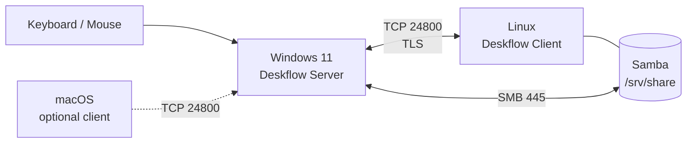

# 一套键鼠，三台电脑

> 用开源 [Deskflow](https://github.com/deskflow/deskflow) 把 Windows、Linux、macOS 接成一张桌子。  
> 也是一次 AI 辅助排障的完整复盘：从“对拷线不支持 Linux”到 24800 只对直连 IP 开放。

**仓库**：<https://github.com/ztguoresearch/one-keyboard-three-systems>  
**项目主页**：<https://ztguoresearch.github.io/one-keyboard-three-systems/>

[](LICENSE-CONTENT.md)
[](LICENSE)
[](CONTRIBUTING.md)


---

## 这仓库是什么

这不是 Deskflow 的官方文档。它是一份**踩过坑、能复现、带日志证据**的实战笔记：

- 为什么市面上的 USB 对拷线救不了 Linux；
- 怎样用一台 Windows 做 Server、一台 Linux 做 Client，共用一套键鼠；
- 网线直连时，IP、防火墙、TLS、剪贴板分别怎么配；
- 图片剪贴板为什么“看起来支持、实际贴不出来”；
- Linux 共享文件夹、Windows 映射 `Z:` 盘的完整步骤；
- AI 在排障中哪些地方真的有用，哪些地方只会添乱。

如果你也在两台或三台电脑之间反复拔插键鼠，这个仓库可能帮你省下几个周末。

## 先看结果

| 项目 | 结果 |
|---|---|
| 软件成本 | **0 元**（Deskflow 开源） |
| 硬件成本 | 一根网线；不需要 KVM 切换器、不需要对拷线 |
| 键鼠切换 | 鼠标穿过屏幕边缘，键盘跟随，体感接近原生 |
| 剪贴板 | 文字、截图/图片像素可同步 |
| 图片文件 | 不支持拖拽/复制文件，请走 Samba |
| 文件互传 | Linux Samba 共享，Windows 映射为 `Z:` 盘 |
| 延迟 | 有线直连下基本无感；Wi-Fi 会明显一些 |
| 安全 | 24800 只绑定直连 IP，防火墙只放行对端 `10.10.10.2` |

> 实测环境：Windows 11 + Ubuntu 系 Linux（NetworkManager），Deskflow 1.27.0。  
> macOS 部分依据官方文档与社区经验整理，本次未实机验证，文中会单独标注。

## 架构




关键点：

- **Server 是插着键鼠的那台**，负责捕获输入；
- **Client 是接收输入的那台**，不要求插键鼠；
- 两端都要运行 Deskflow，缺一不可；
- 文件传输不是 Deskflow 的职责，交给 SMB；
- 直连链路建议单独一个网段，例如 `10.10.10.0/24`。

## 五分钟快速开始

### 1. Windows：安装到纯英文路径

从 [Deskflow Releases](https://github.com/deskflow/deskflow/releases) 下载 `win-x64.msi`，安装到：

```text
C:\Tools\Deskflow
```

**不要装在含中文的路径**，否则 daemon 启动 core 时可能报 `vector too long`。这是本项目踩过的第一个大坑。

### 2. Linux：安装客户端

Ubuntu 22.04/24.04 等没有对应 deb 的版本，优先用 Flatpak：

```bash
sudo apt install flatpak
flatpak remote-add --if-not-exists flathub https://flathub.org/repo/flathub.flatpakrepo
flatpak install flathub org.deskflow.deskflow
```

有对应 deb 的版本也可以直接安装 release 里的 `ubuntu-*-x86_64.deb`。

### 3. 直连静态 IP

Windows：

```text
IP: 10.10.10.1
Mask: 255.255.255.0
Gateway: 留空
```

Linux：

```bash
sudo nmcli con mod "Wired connection 1" \
  ipv4.method manual \
  ipv4.addresses 10.10.10.2/24 \
  ipv4.gateway "" \
  ipv4.never-default yes
sudo nmcli con up "Wired connection 1"
```

### 4. Windows 做 Server

打开 Deskflow：

1. 选“使用此计算机的键盘和鼠标”（Server）；
2. 点“配置服务器”，把 Linux 屏幕放到 Windows 左边或右边；
3. 点“启动”；
4. 防火墙只放行 `10.10.10.2` 访问 `24800`。

### 5. Linux 做 Client

打开 Deskflow：

1. 选“使用另一台计算机的鼠标和键盘”（Client）；
2. 地址填 `10.10.10.1`；
3. 点“连接”。

鼠标移到边界，应该就能过去了。

## 仓库地图

| 文件 | 内容 |
|---|---|
| [`blog/2026-11-09-ai-break-capital-kvm.md`](blog/2026-11-09-ai-break-capital-kvm.md) | 长文：一次对“硬件税”的小小反抗，以及 AI 排障复盘 |
| [`docs/01-why-not-usb-cable.md`](docs/01-why-not-usb-cable.md) | 为什么成品对拷线救不了 Linux |
| [`docs/02-architecture.md`](docs/02-architecture.md) | Server/Client、端口、TLS、剪贴板的数据流 |
| [`docs/03-windows-server.md`](docs/03-windows-server.md) | Windows 端安装、配置、绑定、防火墙 |
| [`docs/04-linux-client.md`](docs/04-linux-client.md) | Linux 端安装、静态 IP、Wayland/X11 |
| [`docs/05-network-security.md`](docs/05-network-security.md) | 直连组网、固定 IP、只允许对端访问 24800 |
| [`docs/06-clipboard.md`](docs/06-clipboard.md) | 文字/图片/文件的区别，图片为什么贴不出来 |
| [`docs/07-samba.md`](docs/07-samba.md) | Linux 共享文件夹 + Windows 映射 `Z:` |
| [`docs/08-troubleshooting.md`](docs/08-troubleshooting.md) | 错误信息对照表：从 `vector too long` 到 TLS 指纹 |
| [`docs/09-ai-workflow.md`](docs/09-ai-workflow.md) | 怎样让 AI 做排障副驾，而不是让它瞎猜 |
| [`docs/10-checklist.md`](docs/10-checklist.md) | 可打印/可勾选的复现清单 |
| [`docs/11-macos.md`](docs/11-macos.md) | macOS 端的注意事项（未实机验证） |
| [`docs/12-publish.md`](docs/12-publish.md) | 推送、GitHub Pages 与社交预览的设置步骤 |
| [`index.html`](index.html) | GitHub Pages 项目主页 |
| [`assets/hero.png`](assets/hero.png) | 主页/社交预览用的架构横幅 |
| [`assets/server-layout.png`](assets/server-layout.png) | Deskflow 服务器配置截图（主机名已打码） |
| [`scripts/windows/start-server.ps1`](scripts/windows/start-server.ps1) | 启动 Windows 服务端 core，并写日志 |
| [`scripts/windows/setup-firewall.ps1`](scripts/windows/setup-firewall.ps1) | 只允许对端访问 24800 的防火墙规则 |
| [`scripts/linux/setup-static-ip.sh`](scripts/linux/setup-static-ip.sh) | 用 nmcli 固定直连 IP |
| [`scripts/linux/setup-samba.sh`](scripts/linux/setup-samba.sh) | 安装并配置 Samba 共享 |

## 三条最重要的经验

1. **安装路径不要有中文。**  
   `E:\资料\...\deskflow` 会触发 daemon 的路径 bug；`C:\Tools\Deskflow` 或 `E:\Tools\Deskflow` 都可以。

2. **先配静态 IP，再谈连接。**  
   直连没有 DHCP，Windows 会拿到 `169.254.x.x`，Linux 也可能没有地址。两端必须在同一网段，例如 `10.10.10.1/24` 和 `10.10.10.2/24`。

3. **一台机器只留一个 Deskflow 实例。**  
   旧路径 GUI + 新路径 GUI + Windows 服务同时跑，会抢 24800、抢剪贴板，报 `daemon ipc ... 无效名称` 和 `OpenClipboard 失败`。

## 仓库与主页

- 仓库：<https://github.com/ztguoresearch/one-keyboard-three-systems>
- 主页：<https://ztguoresearch.github.io/one-keyboard-three-systems/>（已启用）
- 推送、Pages、社交预览的步骤：[`docs/12-publish.md`](docs/12-publish.md)

## 适用与不适用

**适合：**

- 办公、写代码、查资料，需要一套键鼠控制多台电脑；
- Windows + Linux 双机，或再加一台 macOS；
- 不希望购买 KVM 切换器/对拷线；
- 能接受一次性的命令行配置。

**不适合：**

- 竞技游戏、反作弊环境；
- 需要“复制文件直接粘贴”的场景（请用 Samba）；
- 完全不想碰命令行、也不想看日志；
- 在公共 Wi-Fi 上长期开放 24800 端口。

## 许可证

- 文章与图片：CC BY-SA 4.0，见 [`LICENSE-CONTENT.md`](LICENSE-CONTENT.md)
- 脚本代码：MIT，见 [`LICENSE`](LICENSE)

欢迎提 Issue / PR 纠错，尤其是 macOS 和 Wayland 的实测补充。
