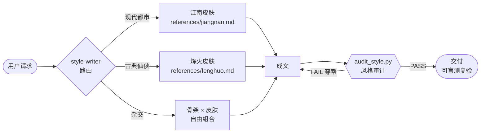

<div align="center">


# longzu.skillls

**江南 × 烽火戏诸侯 · 文风蒸馏 Agent Skills**

*Claude Code / Codex / Cursor / Trae / Antigravity / WorkBuddy…任何 agent 通用*

[](#-安装到你的-agent)
[](FIDELITY.md)
[](#-方法论为什么它不是印象流)
[](#-三个-skill)
[](#-审计脚本)
[](LICENSE)

*把 1465 万字原著蒸馏成可执行、可审计、可盲测复验的写作引擎。*

</div>

---

## 👀 风格橱窗

同一支笔，三种血统——前两段由本仓库 skill 生成并通过独立盲测归属判定，第三段是盲测用的阴性对照：

> **江南味** ✅（盲测判定 8/10）
> 响了七声，没人接。第八声的时候他挂了。规矩是他自己定的，响八声就挂，显得没那么迫切，虽然全世界都知道他迫切得要死。

> **烽火味** ✅（盲测判定 8.5/10）
> "使得使不得，不看东西贵贱，看拿东西的人，配不配。三十年后，你自会知道今日配不配。"

> **通用 AI 腔** ❌（评审语："通篇即是出戏本身"）
> 命运的齿轮，已经开始缓缓转动。他的嘴角勾起一抹冷冽的弧度……

完整样本与评审判词见 [FIDELITY.md](FIDELITY.md)。

## 📦 三个 Skill

| Skill | 定位 | 一句话 |
|---|---|---|
| [`style-writer`](style-writer/) ⭐ | **融合版（推荐）** | 薄路由 + 共享叙事骨架 + 皮肤按需加载，支持风格杂交（"江南的情绪弧线 × 烽火的皮"） |
| [`jiangnan-writer`](jiangnan-writer/) | 江南独立版 | 现代都市奇幻/青春疼痛：吐槽流叙述、先笑后哭、泪点不解释 |
| [`fenghuo-writer`](fenghuo-writer/) | 烽火独立版 | 仙侠江湖/庙堂：半文半白、讲道理、短段呼吸、强者写淡 |

## 🏗 工作原理



两位作者**骨头像、皮肤不像**：短句重锤、情感转译不直说、泪点不解释等 7 条共享骨架写在融合版主文件；互斥的语言皮肤（语域/对话动词/标点/时间词/段落节奏"五件套"）分文件按需加载，杂交时五件套成套不拆。

## 🔬 方法论：为什么它不是"印象流"

三层证据，层层可复验：

1. **全文量化统计（100% 覆盖）**——《龙族1-4》220万字 + 《剑来》1245万字逐字扫描。硬证据如：《剑来》"笑道"14140 次而《龙族》仅 4 次；"道理"一词 3130 次（平均每四千字讲一次）；烽火感叹号密度只有江南的 1/5
2. **等距精读采样（45 个点）**——两书从头到尾均匀取样精读，蒸馏叙事策略、对话结构、情绪弧线，逐条记入 [corpus-notes](style-writer/references/)
3. **独立盲测出厂质检**——生成样本交给禁用本地资源的独立评审 agent 盲判（0 次工具调用），5/5 归属全对、阴性对照精准剔除，总分 **95/100 · A**，全程记录（含第一轮因评审偷看 skill 而作废的反作弊插曲）在 [FIDELITY.md](FIDELITY.md)

诚实边界也写进了 skill 本体：江南规则仅保真**龙族期**（九州/上海堡垒未采样），烽火规则仅保真**剑来期**（雪中/陈二狗未采样）；"道/说"之分标注为语域惯例而非作者指纹。

## 🚀 安装到你的 Agent

技能本体只是 markdown + 一个零依赖的 Python 脚本，**任何能读文件或接受系统提示的 agent 都能用**：

| 你的 Agent | 安装方法 |
|---|---|
| **Claude Code** | skill 文件夹复制到 `~/.claude/skills/`，按触发词自动激活 |
| **Codex / Gemini CLI 等读 AGENTS.md 的工具** | 把本仓库 clone 进项目（或工作目录），根目录的 [AGENTS.md](AGENTS.md) 会自动指挥 agent：路由 → 读规则 → 跑审计 |
| **Cursor** | `standalone/` 单文件版放入 `.cursor/rules/`，或粘贴为 Project Rules |
| **Trae / WorkBuddy / Antigravity 等** | `standalone/` 单文件版粘贴为规则 / 系统提示 / 自定义指令 |
| **任意网页对话**（ChatGPT、Gemini、Kimi…） | 把 [`standalone/style-writer-standalone.md`](standalone/style-writer-standalone.md) 全文贴进对话开头即可 |

```bash
git clone https://github.com/zuoyou12/longzu.skillls.git
# Claude Code 示例（Windows: 复制到 %USERPROFILE%\.claude\skills\）
cp -r longzu.skillls/style-writer ~/.claude/skills/
```

`standalone/` 三个单文件版：`style-writer-standalone.md`（融合全量，推荐）、`jiangnan-standalone.md`、`fenghuo-standalone.md`——规则+角色表合并为一个 markdown，无需文件系统。

装好后直接说：

- 「用江南的文笔写一段高三男生的暗恋」
- 「按剑来的味道，写一场老江湖讲规矩的客栈戏」
- 「用江南的情绪弧线写仙侠」（杂交模式，仅 style-writer）

## 🧰 审计脚本

写完让 Claude 跑一遍，或自己跑：

```bash
python style-writer/scripts/audit_style.py --author fenghuo 草稿.md
```

```text
== 草稿.md ==  (3204字)
  感叹号6.2/万 问号31.0/万 省略号3.1/万 句长均值41.7 段落中位36 超短段18.2%
  [PASS] 全部指标在语料区间内
```

硬性项（对话动词体系穿帮）直接 FAIL 并返回非零退出码，可挂进 CI；节奏项与语料实测区间比对给 WARN。

## ⚖️ 声明

本项目为**非商业性质的文学风格研究与同人写作辅助工具**，与江南（杨治）、烽火戏诸侯本人及其出版方无关，不构成官方续作。《龙族》《剑来》等作品著作权归原作者及权利方所有；仓库内仅含风格分析笔记，原文引用控制在句子级评论例证范围。使用本 skill 产出的内容请标注"同人/仿写"，并遵守发布平台与权利方的相关规则。代码（审计脚本等）以 [MIT](LICENSE) 许可发布。

## 🙏 致谢

- 保真度评分卡与反作弊盲测方法论改造自 [alchaincyf/nuwa-skill](https://github.com/alchaincyf/nuwa-skill)（女娲）
- 江南与烽火戏诸侯——规则可以蒸馏，才华蒸馏不了

---

<div align="center">

**如果这个仓库对你有用，点个 ⭐ 吧**

</div>
