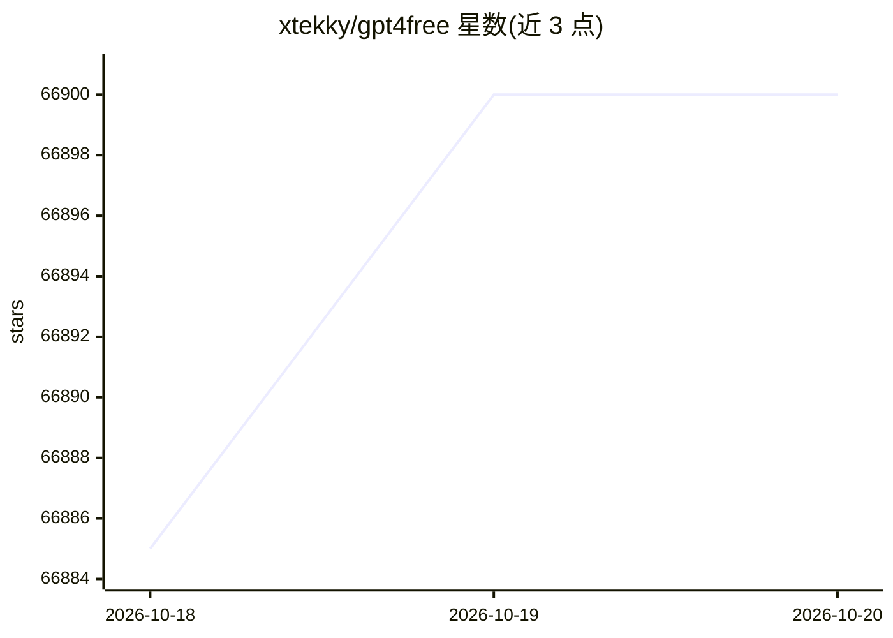
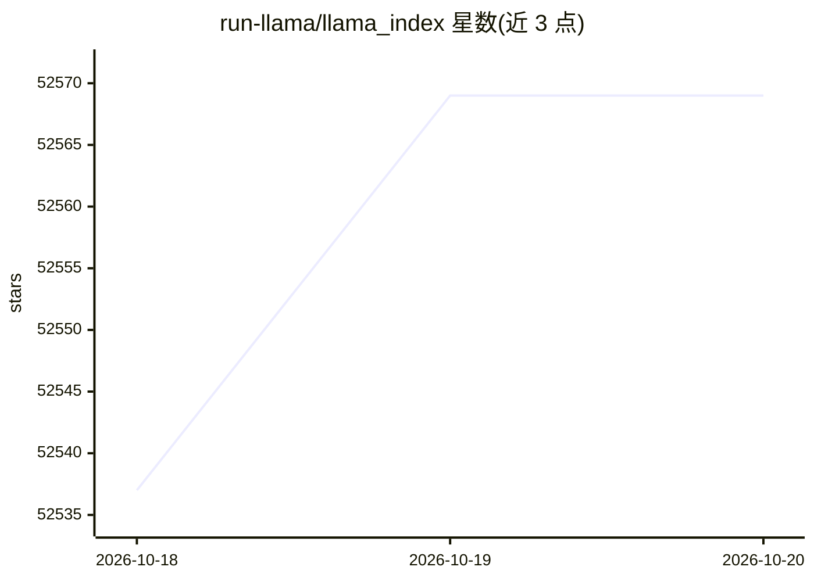
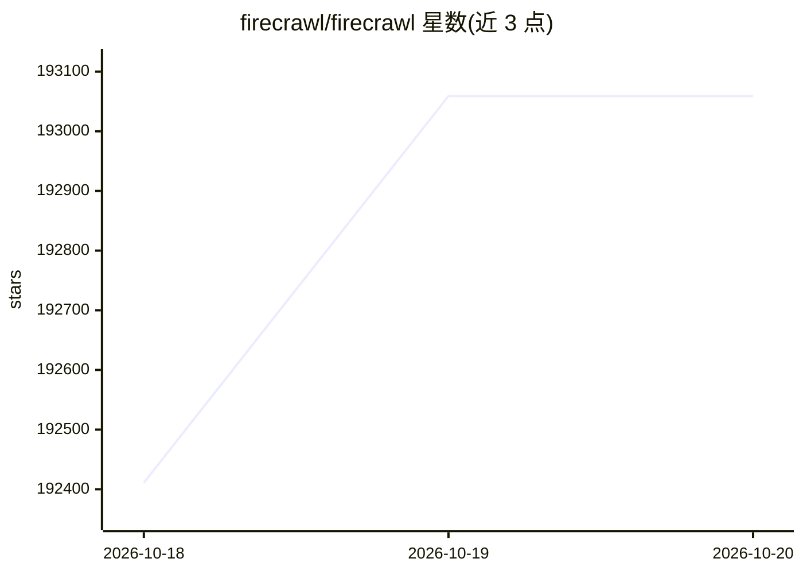
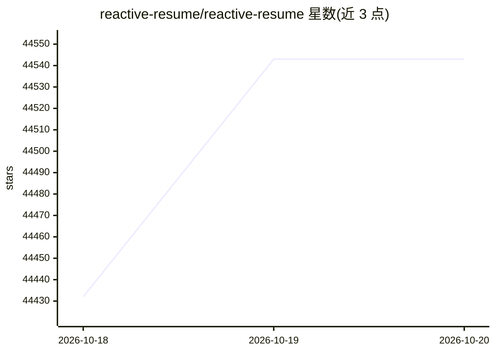
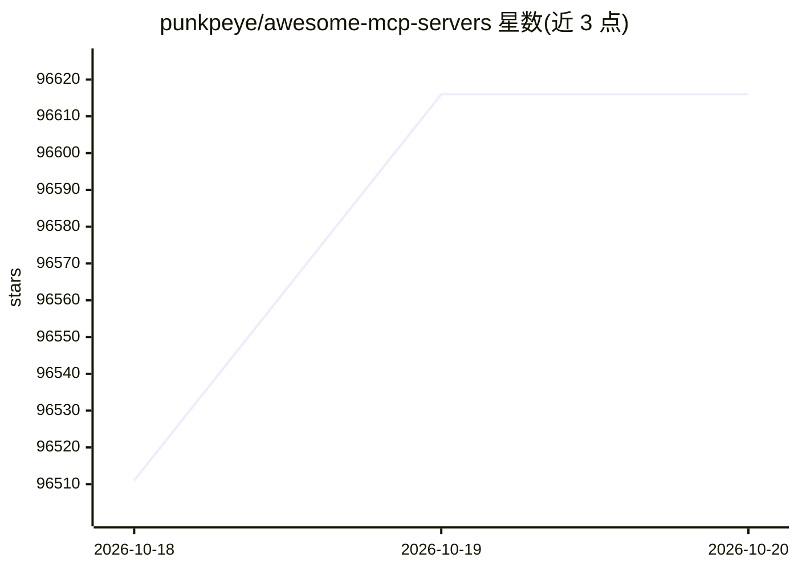
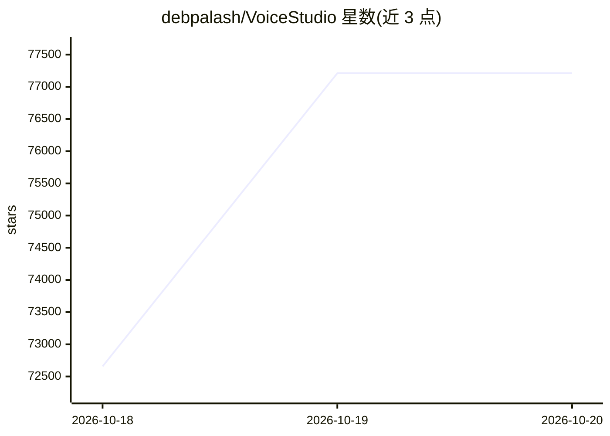
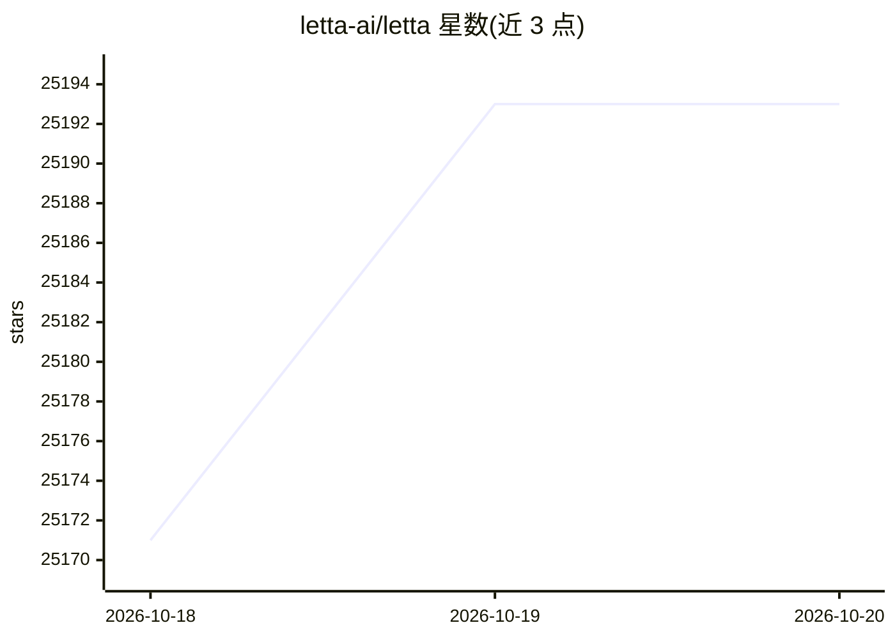

# 放量验收样本:10 张卡片(含星数曲线)

> 生成 2026-10-20 · 公开仓同款渲染 · 曲线为 mermaid,GitHub/静态站原生渲染

# xtekky/gpt4free

⭐ 66,900 · Python · GPL-3.0 · 推送 2026-10-19 · [GitHub](https://github.com/xtekky/gpt4free) · [官网](https://t.me/g4f_channel) · 个人维护

**聚合多家 LLM 提供商的接入层：统一 API、GUI 与客户端**

社区项目 g4f 聚合多个可访问的模型提供商（OpenAI 兼容端点、Gemini、MetaAI、Pollinations 媒体生成及本地推理后端），对外提供 OpenAI 兼容的 FastAPI Interference API、可选本地 Web GUI、Python/JS 客户端、CLI，以及供 AI 助手调用的 MCP 服务器（web 搜索、抓取、图像生成工具）。支持 Docker 全量与 slim 镜像部署（x86_64/arm64），部分提供商需要 Chrome/Chromium、API key 或 cookies/HAR 文件，遵循 GPL v3 许可。

## 筛选速览

| 维度 | 判定 | 备注 |
|---|---|---|
| AI 角色 | `ai-ecosystem` | LLM/agent 周边工具 |
| 许可风险 | `viral` | GPL-3.0 |
| 部署形态 | `self-host` | docker 或自建部署 |
| 模型依赖 | — | README 未给出锁定关系 |
| 硬件要求 | — | 无带数字的原话,不猜 |
| 安装摩擦 | `low` | 无编译、无系统依赖或容器化 |
| 成熟度 | — | 结构信号不足 |

## 动量与使用信号

- 维护:`active` — 距上次 push 0.7 天,年发版 100,268 位贡献者
- 涨星:近 1 天 **+5**(自 20261016 起算)
- 安装:pypi 包 `g4f` 月下载 71,487
- 平台:WINDOWS / MACOS / LINUX · 协议:OPENAI-API / MCP

## 能力要点

- 多提供商适配器：LLM、媒体生成与本地推理后端
- FastAPI 实现的 OpenAI 兼容 Interference API 与可选 Web GUI
- Python 同步/异步客户端与浏览器 JS 客户端
- MCP 服务器（stdio/HTTP 模式）提供 web_search/web_scrape/image_generation 工具

## 适用场景

- 用统一接口调用多个 LLM 与媒体生成提供商
- 为现有 OpenAI 兼容工作流提供统一入口端点
- 让 Claude 等 AI 助手通过 MCP 获得网页搜索与图像生成能力
- 在 Docker 中自托管 API 与 GUI 并做提供商登录管理

## 场景标签

`模型网关` · 领域:Agent 开发

## 证据(README 行号)

> L17: GPT4Free (g4f) is a community-driven project that aggregates multiple accessible providers and interfaces to make w
> L27: - FastAPI-based OpenAI-compatible API (Interference API).
> L296: ## Inference API (OpenAI‑compatible)

## 星数曲线

2026-10-18 66,885 → 2026-10-20 66,900（+15）

---
*卡片 v1 · prompt 1.4 · 生成 2026-10-20 · 置信度 high · 依据 README sha `e61f21748cbc` · [字段定义](../../DATASET.md)*

---

# OpenHands/OpenHands

⭐ 91,292 · TypeScript · MIT · 推送 2026-10-19 · [GitHub](https://github.com/OpenHands/OpenHands) · [官网](https://openhands.dev) · 组织维护

**自托管的编码 agent 控制中心：统一运行与管理多种 coding agent**

OpenHands Agent Canvas 是一个自托管的开发者控制中心，用于启动对话与自动化日常任务（如发布到 Slack 的报告、自动拆解 GitHub issue 为任务）。默认本地运行，可连接多种 agent 后端：本地、Docker 容器、VM 或云端（OpenHands Cloud/Enterprise）。开箱运行开源 OpenHands agent，也可接入 Claude Code、Codex、Gemini、Pi、OpenCode 等 ACP 兼容第三方 agent。提供 npm 全局安装、Docker 沙箱（含多容器隔离）与源码运行三种方式，并支持定时/webhook 触发的自动化与 Slack、GitHub、Linear 等集成。项目标注为 beta。

## 筛选速览

| 维度 | 判定 | 备注 |
|---|---|---|
| AI 角色 | `ai-ecosystem` | LLM/agent 周边工具 |
| 许可风险 | `permissive` | MIT |
| 部署形态 | `library` | 以包/库形式分发 |
| 模型依赖 | — | README 未给出锁定关系 |
| 硬件要求 | — | 无带数字的原话,不猜 |
| 安装摩擦 | `low` | 无编译、无系统依赖或容器化 |
| 成熟度 | `idea` | |

## 动量与使用信号

- 维护:`active` — 距上次 push 0.6 天,年发版 63,461 位贡献者
- 涨星:近 1 天 **+101**(自 20261016 起算)
- 安装:npm 包 `@openhands/agent-canvas` 月下载 17,530

## 能力要点

- 本地/Docker/VM/云端多后端切换运行 agent
- 支持 OpenHands、Claude Code、Codex、Gemini、Pi、OpenCode 及任意 ACP 兼容 agent
- Automations：按计划或 webhook 事件触发，集成 Slack/GitHub/Linear/Notion
- Docker 沙箱与多容器隔离（每个会话独立容器）

## 适用场景

- 在自己机器或服务器上集中运行多个编码 agent
- 把 GitHub issue 自动拆解为任务并生成发布到 Slack 的报告
- 团队共享 Agent Server 做代码审查与依赖更新

## 场景标签

`编码 Agent` · 领域:编码与开发

## 证据(README 行号)

> L25: OpenHands Agent Canvas turns your coding agents into a self-hosted, always-on engineering team. It's a developer co
> L29: Agent Canvas runs the open source OpenHands agent out-of-the-box, but can use third-party agents such as Claude Cod
> L133: Agent Canvas is powered by the OpenHands Agent Server, a REST API for running multiple agents on a single machine.

## 星数曲线

2026-10-18 91,122 → 2026-10-20 91,292（+170）

---
*卡片 v1 · prompt 1.4 · 生成 2026-10-20 · 置信度 high · 依据 README sha `c23ab7c385e3` · [字段定义](../../DATASET.md)*

---

# run-llama/llama_index

⭐ 52,569 · Python · MIT · 推送 2026-10-14 · [GitHub](https://github.com/run-llama/llama_index) · [官网](https://developers.llamaindex.ai) · 组织维护

**构建 LLM/Agent 应用的开源数据框架（RAG 工具集）**

LlamaIndex 是一个帮助开发者构建 LLM 应用与 agentic 应用的开源数据框架：提供数据连接器（APIs、PDFs、docs、SQL 等）接入私有数据，以索引/图结构组织数据，并给出检索/查询接口，使 LLM 能基于私有数据生成知识增强输出。采用核心包加 300+ 集成插件的架构，可搭配任意 LLM、嵌入模型与向量库。高层 API 可 5 行代码完成数据摄取与查询，底层 API 支持定制各模块。维护方公司当前主要重心已转向 LlamaParse 平台。

## 筛选速览

| 维度 | 判定 | 备注 |
|---|---|---|
| AI 角色 | `ai-ecosystem` | LLM/agent 周边工具 |
| 许可风险 | `permissive` | MIT |
| 部署形态 | `library` | 以包/库形式分发 |
| 模型依赖 | local-ok | 支持本地模型 |
| 硬件要求 | — | 无带数字的原话,不猜 |
| 安装摩擦 | `low` | 无编译、无系统依赖或容器化 |
| 成熟度 | — | 结构信号不足 |

## 能力要点

- 数据连接器摄取 APIs/PDFs/docs/SQL 等多种数据源
- 索引/图结构组织数据，提供检索与知识增强查询接口
- 300+ 集成包，可搭配自选 LLM、嵌入与向量库提供商
- 核心包内置 nltk 与 tiktoken 缓存，适应受限磁盘环境

## 适用场景

- 把企业私有文档接入 LLM 做 RAG 问答
- 用 Ollama 或 HuggingFace 模型本地构建向量索引与查询
- 定制数据连接器、检索器、查询引擎等模块构建应用

## 场景标签

`RAG` `Agent 框架` · 领域:Agent 开发

## 证据(README 行号)

> L82: That's where **LlamaIndex** comes in. LlamaIndex is a "data framework" to help you build LLM apps. It provides the 
> L84: - Offers **data connectors** to ingest your existing data sources and data formats (APIs, PDFs, docs, SQL, etc.).
> L86: - Provides an **advanced retrieval/query interface over your data**: Feed in any LLM input prompt, get back retriev

## 星数曲线

2026-10-18 52,537 → 2026-10-20 52,569（+32）

---
*卡片 v1 · prompt 1.4 · 生成 2026-10-20 · 置信度 high · 依据 README sha `88ce08edabec` · [字段定义](../../DATASET.md)*

---

# deepspeedai/DeepSpeed

⭐ 43,245 · Python · Apache-2.0 · 推送 2026-10-19 · [GitHub](https://github.com/deepspeedai/DeepSpeed) · [官网](https://www.deepspeed.ai/) · 组织维护 · 中文 README

**大规模深度学习分布式训练与推理优化库**

微软开源的深度学习优化库，提供 ZeRO、ZeRO-Infinity、3D 并行、Ulysses 序列并行、MoE 等系统技术，用于训练与推理千亿至万亿参数模型；已集成 Transformers、Accelerate、Lightning 等框架。通过 pip 安装，默认以 JIT 方式编译 C++/CUDA 扩展，需先装 PyTorch 与 CUDA/ROCm 编译器；支持 NVIDIA/AMD GPU 及 Ascend NPU、Gaudi、XPU 等多种加速器，Windows 上部分功能不可用（如 AIO、GDS）。

## 筛选速览

| 维度 | 判定 | 备注 |
|---|---|---|
| AI 角色 | `ai-ecosystem` | LLM/agent 周边工具 |
| 许可风险 | `permissive` | Apache-2.0 |
| 部署形态 | `library` | 以包/库形式分发 |
| 模型依赖 | — | README 未给出锁定关系 |
| 硬件要求 | — | 无带数字的原话,不猜 |
| 安装摩擦 | `high` | 编译与系统依赖俱全 |
| 成熟度 | — | 结构信号不足 |

## 动量与使用信号

- 维护:`active` — 距上次 push 0.7 天,年发版 17,433 位贡献者
- 涨星:近 1 天 **+2**(自 20261016 起算)
- 安装:pypi 包 `deepspeed` 月下载 1,054,708

## 能力要点

- ZeRO/ZeRO-Infinity/3D 并行等分布式训练技术
- 与 Transformers、Accelerate、Lightning 等框架集成
- pip 安装，扩展默认 JIT 编译，提供 ds_report 环境诊断
- 支持 NVIDIA/AMD GPU 及 Ascend、Gaudi、XPU 等多种加速器

## 适用场景

- 训练千亿级参数的大规模语言模型
- 在有限显存下做大模型训练与推理优化
- 在 PyTorch 生态中使用 DeepSpeed 加速分布式训练

## 场景标签

`模型训练` `推理引擎` `模型量化` · 领域:训练与推理

## 证据(README 行号)

> L54: ***DeepSpeed enabled the world's most powerful language models (at the time of this writing) such as MT-530B and BL
> L80: |Transformers with DeepSpeed|

## 星数曲线

2026-10-18 43,238 → 2026-10-20 43,245（+7）

---
*卡片 v1 · prompt 1.4 · 生成 2026-10-20 · 置信度 high · 依据 README sha `5b0929de9c8c` · [字段定义](../../DATASET.md)*

---

# firecrawl/firecrawl

⭐ 193,059 · TypeScript · AGPL-3.0 · 推送 2026-10-19 · [GitHub](https://github.com/firecrawl/firecrawl) · [官网](https://firecrawl.dev) · 组织维护

**面向 AI agent 的网页搜索/抓取/交互 API 与开源工具集**

Firecrawl 提供网页搜索、抓取、整站爬取、URL 发现、批量抓取与内容变更监控等 API，将网页与 PDF/DOCX 等文档转为 markdown、结构化 JSON 或截图，供 AI agent 使用。支持在页面上执行点击、滚动、输入等操作后提取内容，并提供描述需求的 Agent 端点（运行 spark-2 模型）。提供 Python/Node/Go/Java/Rust 等 SDK、CLI 与 MCP 集成，可接入 Claude Code 等 agent 客户端。AGPL-3.0 开源，另有含额外功能的云端托管版，支持自托管。

## 筛选速览

| 维度 | 判定 | 备注 |
|---|---|---|
| AI 角色 | `ai-ecosystem` | LLM/agent 周边工具 |
| 许可风险 | `viral` | AGPL-3.0 |
| 部署形态 | `library` | 以包/库形式分发 |
| 模型依赖 | — | README 未给出锁定关系 |
| 硬件要求 | — | 无带数字的原话,不猜 |
| 安装摩擦 | `medium` | 含编译或系统依赖之一 |
| 成熟度 | — | 结构信号不足 |

## 动量与使用信号

- 维护:`active` — 距上次 push 0.7 天,年发版 7,166 位贡献者
- 涨星:近 1 天 **+426**(自 20261016 起算)
- 安装:pypi 包 `firecrawl-py` 月下载 5,339,910
- 平台:— · 协议:MCP

## 能力要点

- 网页/文档转 markdown、JSON、截图等 LLM-ready 输出
- 页面交互（点击/滚动/输入）后提取内容
- Agent 端点：描述需求即自动搜索导航取数，支持 schema 结构化输出
- 提供多语言 SDK、CLI 与 MCP 接入方式

## 适用场景

- 为 AI agent 或 RAG 流程获取干净的网页上下文
- 整站爬取与批量抓取构建数据集
- 监控网站内容变更
- 把 PDF/DOCX 文档转为 markdown 供下游处理

## 场景标签

`网页抓取` `浏览器自动化` · 领域:效率与自动化

## 证据(README 行号)

> L31: **The API to search, scrape, and interact with the web at scale. Firecrawl is the context API for AI agents. 🔥** Op
> L213: Connect Firecrawl to any AI agent or MCP client in minutes.

## 星数曲线

2026-10-18 192,411 → 2026-10-20 193,059（+648）

---
*卡片 v1 · prompt 1.4 · 生成 2026-10-20 · 置信度 high · 依据 README sha `c63714794e25` · [字段定义](../../DATASET.md)*

---

# reactive-resume/reactive-resume

⭐ 44,543 · TypeScript · MIT · 推送 2026-10-19 · [GitHub](https://github.com/reactive-resume/reactive-resume) · [官网](https://rxresu.me) · 组织维护

**开源自托管简历构建器：写简历、检查、投递追踪与可选 AI 助手**

面向求职者的免费开源简历/求职信构建器：提供所见即所得编辑器、18 套模板、可读性检查、职位关键词匹配、求职申请看板与日历追踪，导出 PDF/Word/Markdown/JSON 并支持公开链接分享。AI 为可选功能：文档旁助手可提出编辑建议（逐条接受/拒绝）、写作审阅、根据职位起草求职信，需自行连接 OpenAI、Anthropic、Gemini、OpenRouter、Ollama 等提供商；JSON/LinkedIn/PDF 导入不依赖 AI，Word 导入需连接提供商。可自托管（Docker、Vercel、Cloudflare Workers 等），MIT 许可，无跟踪无广告。

## 筛选速览

| 维度 | 判定 | 备注 |
|---|---|---|
| AI 角色 | `ai-enhanced` | 去掉 AI 部分产品仍成立 |
| 许可风险 | `permissive` | MIT |
| 部署形态 | `self-host` | docker 或自建部署 |
| 模型依赖 | local-ok | 支持本地模型 |
| 硬件要求 | — | 无带数字的原话,不猜 |
| 安装摩擦 | `low` | 无编译、无系统依赖或容器化 |
| 成熟度 | — | 结构信号不足 |

## 动量与使用信号

- 维护:`active` — 距上次 push 0.7 天,年发版 49,234 位贡献者
- 涨星:近 1 天 **+69**(自 20261016 起算)
- 平台:— · 协议:MCP / OLLAMA

## 能力要点

- 18 套模板与 ATS 友好筛选，实时 PDF 预览
- 可读性检查、职位关键词匹配与浏览器端公开 ATS 检查器
- 可选 AI 助手：提议式编辑、写作审阅、按职位起草求职信，需自接提供商
- 求职申请追踪（列表/看板/洞察/日历）与 REST API、MCP server

## 适用场景

- 编写和定制简历，导出 PDF/Word/Markdown 并公开分享
- 对照职位描述检查简历关键词匹配与可读性
- 追踪投递进度、面试安排与联系人
- 在自己服务器上自托管完整应用，掌控数据

## 场景标签

 · 领域:求职/文档工具

## 证据(README 行号)

> L12:  Reactive Resume is a free and open-source resume builder for writing resumes and cover letters, checking your work
> L47: You own your data. The codebase is open source under the MIT license, with no tracking, no ads, and no paid tier. O
> L107: - Connect OpenAI, Anthropic, Google Gemini, OpenRouter, Ollama, or other supported providers and compatible endpoi
> L113: - JSON, LinkedIn, and readable PDF imports work without AI; Word imports require a connected provider

## 星数曲线

2026-10-18 44,432 → 2026-10-20 44,543（+111）

---
*卡片 v1 · prompt 1.4 · 生成 2026-10-20 · 置信度 high · 依据 README sha `2602fafa4a22` · [字段定义](../../DATASET.md)*

---

# meilisearch/meilisearch

⭐ 59,612 · Rust · NOASSERTION · 推送 2026-10-19 · [GitHub](https://github.com/meilisearch/meilisearch) · [官网](https://www.meilisearch.com) · 组织维护

**面向应用与网站的开源搜索引擎，提供全文/语义/混合搜索 API**

开源搜索引擎（MIT，Community Edition），以 RESTful API 提供全文、语义与混合搜索，支持容错、过滤分面、地理搜索、多租户、排序与同义词。AI 相关能力包括基于索引数据的对话式搜索（AI 生成回答）、原生 MCP 服务器（/mcp，实验性）、LangChain 向量存储集成。运行方式包括托管云服务与自托管（Docker、二进制、Homebrew、APT）；另有需商业协议的 Enterprise Edition（分片等）。由法国公司 Meili 开发。

## 筛选速览

| 维度 | 判定 | 备注 |
|---|---|---|
| AI 角色 | `ai-enhanced` | 去掉 AI 部分产品仍成立 |
| 许可风险 | `none` | NOASSERTION |
| 部署形态 | `desktop` | 安装包/桌面程序 |
| 模型依赖 | — | README 未给出锁定关系 |
| 硬件要求 | — | 无带数字的原话,不猜 |
| 安装摩擦 | `low` | 无编译、无系统依赖或容器化 |
| 成熟度 | `idea` | |

## 动量与使用信号

- 维护:`active` — 距上次 push 2.7 天,年发版 63,229 位贡献者
- 涨星:近 1 天 **+10**(自 20261016 起算)
- 平台:— · 协议:MCP

## 能力要点

- 全文/语义/混合搜索，支持容错与 50 毫秒内搜索即输即显
- 原生 MCP 服务器（实验性）与 LangChain 向量存储集成
- 对话式搜索：基于索引数据生成自然语言回答
- 优化支持中文、日文等多种语言的分词

## 适用场景

- 为网站或应用接入带容错的站内搜索
- 电商场景做多租户、分面过滤搜索
- 作为 RAG / AI agent 的检索后端（MCP、LangChain）
- 为 LLM 与编码代理提供文档（llms.txt）

## 场景标签

`语义搜索` · 领域:知识与检索

## 证据(README 行号)

> L22: Meilisearch is a search engine for fast, relevant full-text, semantic, and hybrid search. The easiest way to get st
> L87: - **Hybrid search:** Combine the best of both semantic & full-text search to get the most relevant results
> L99: - **Conversational search:** let users ask questions in natural language and get AI-generated answers grounded in y

## 星数曲线

2026-10-18 59,591 → 2026-10-20 59,612（+21）

---
*卡片 v1 · prompt 1.4 · 生成 2026-10-20 · 置信度 high · 依据 README sha `25bf1ffe0c7b` · [字段定义](../../DATASET.md)*

---

# punkpeye/awesome-mcp-servers

⭐ 96,616 · MIT · 推送 2026-10-18 · [GitHub](https://github.com/punkpeye/awesome-mcp-servers) · [官网](https://glama.ai/mcp/servers) · 个人维护 · 中文 README

**MCP 服务器策展清单：收录可自托管的服务器实现**

punkpeye 维护的 Model Context Protocol (MCP) 服务器策展清单，收录带 GitHub 仓库、需用户自行安装运行的服务器实现，另有配套的远程服务器清单。条目按 50 余个类别组织（聚合器、数据库、浏览器自动化、生物信息、编码代理等），并用图例标注官方实现、编程语言、云/本地范围与操作系统。清单附教程、社区入口，并有与仓库同步的 web 目录。README 提供多语言版本（含简体/繁体中文）。

## 筛选速览

| 维度 | 判定 | 备注 |
|---|---|---|
| AI 角色 | `ai-knowledge` | 知识聚合/清单类 |
| 许可风险 | `permissive` | MIT |
| 部署形态 | `library` | 以包/库形式分发 |
| 模型依赖 | — | README 未给出锁定关系 |
| 硬件要求 | — | 无带数字的原话,不猜 |
| 安装摩擦 | `low` | 无编译、无系统依赖或容器化 |
| 成熟度 | — | 结构信号不足 |

## 动量与使用信号

- 维护:`active` — 距上次 push 3.0 天,年发版 0,443 位贡献者
- 涨星:近 1 天 **+88**(自 20261016 起算)
- 平台:WINDOWS / MACOS / LINUX / WEB · 协议:OPENAI-API / MCP / OLLAMA

## 能力要点

- 按 50+ 类别组织的 MCP 服务器条目
- 图例标注官方实现、语言、云/本地、操作系统
- 配套远程服务器清单与同步的 web 目录
- 含教程与社区入口（Discord/Subreddit）

## 适用场景

- 为 MCP 客户端查找可自托管的服务器实现
- 按类别浏览 MCP 生态覆盖的工具与数据源
- 查找 MCP 入门教程与客户端清单

## 场景标签

`精选清单` · 领域:学习与行业

## 证据(README 行号)

> L16: A curated list of awesome Model Context Protocol (MCP) servers.
> L22: MCP is an open protocol that enables AI models to securely interact with local and remote resources through standar

## 星数曲线

2026-10-18 96,511 → 2026-10-20 96,616（+105）

---
*卡片 v1 · prompt 1.4 · 生成 2026-10-20 · 置信度 high · 依据 README sha `c850a8aa139e` · [字段定义](../../DATASET.md)*

---

# debpalash/VoiceStudio

⭐ 77,211 · Python · AGPL-3.0 · 推送 2026-10-19 · [GitHub](https://github.com/debpalash/VoiceStudio) · [官网](https://voicestudio.sh) · 个人维护 · 中文 README

**本地优先的开源语音工作站：克隆、配音、转写、有声书**

Electron 桌面应用，聚合语音克隆、语音设计、视频配音、听写、转写与有声书创作等功能，宣称支持 646 种语言。默认引擎为 k2-fpa/OmniVoice（原文 k2-fsa），可切换其他引擎并管理本地语音模型。本地工作流在用户硬件上运行，远程服务为可选；提供本地 API 与 MCP 供 agent 接入。分发方式含一键安装脚本（macOS/Linux/Windows）与 Releases 安装包（.dmg/.exe/.AppImage/.deb），也可从源码运行（Node.js 22+/Bun/Rust）。AGPL-3.0 许可。

## 筛选速览

| 维度 | 判定 | 备注 |
|---|---|---|
| AI 角色 | `ai-native` | 本体是模型或模型工具 |
| 许可风险 | `dual` | AGPL-3.0 |
| 部署形态 | `desktop` | 安装包/桌面程序 |
| 模型依赖 | — | README 未给出锁定关系 |
| 硬件要求 | — | 无带数字的原话,不猜 |
| 安装摩擦 | `medium` | 含编译或系统依赖之一 |
| 成熟度 | `idea` | |

## 动量与使用信号

- 维护:`active` — 距上次 push 0.7 天,年发版 42,89 位贡献者
- 涨星:近 1 天 **+3,065**(自 20261016 起算)
- 安装:npm 包 `skills` 月下载 23,786,800
- 平台:WINDOWS / MACOS / LINUX · 协议:MCP

## 能力要点

- 语音克隆、语音设计、视频配音、转写、听写与有声书创作集成于一个桌面应用
- 本地优先：工作流在本机硬件运行，远程服务可选
- 提供本地 API 与 MCP 接入 agent，可复用配方与监视文件夹
- 默认引擎 k2-fsa/OmniVoice，支持安装管理多个本地语音模型

## 适用场景

- 用参考录音克隆声音并生成配音或旁白
- 为视频生成带时间轴的多语言配音
- 在无 GPU 或 Apple Silicon 设备上本地完成转写与听写

## 场景标签

`语音合成` `语音识别` · 领域:内容生成

## 证据(README 行号)

> L6:  Open-source voice cloning, voice design, video dubbing, dictation, transcription & audiobook creation in 646 langua
> L27: |Clone a voice or design your own|Dub videos with timed speech|Local API & MCP for agents|
> L30: Start with **VoiceStudio** (default, powered by k2-fsa/OmniVoice), or choose another engine. Features & engine cata

## 星数曲线

2026-10-18 72,657 → 2026-10-20 77,211（+4,554）

---
*卡片 v1 · prompt 1.4 · 生成 2026-10-20 · 置信度 mid · 依据 README sha `49da35d42ba1` · [字段定义](../../DATASET.md)*

---

# letta-ai/letta

⭐ 25,193 · Apache-2.0 · 推送 2026-10-18 · [GitHub](https://github.com/letta-ai/letta) · [官网](https://docs.letta.com/) · 组织维护

**构建带持久记忆、可自我改进的有状态 AI agent 平台**

Letta（前身为 MemGPT）提供构建有状态 agent 的平台：agent 具备可随时间学习和改进的记忆能力。当前源码位于 letta-ai/letta-code，包含 agent 运行框架、交互式终端 UI、App Server、channels 及桌面/网页应用所用运行时。通过 npm 全局安装 @letta-ai/letta-code 后可用 letta 命令启动终端 UI，或 letta server 运行本地/自托管 App Server；也可通过浏览器、Slack/Telegram/Discord、TypeScript Agent SDK 及 Letta Cloud 使用。archive 分支保留已退役的 V1 API 服务器。

## 筛选速览

| 维度 | 判定 | 备注 |
|---|---|---|
| AI 角色 | `ai-ecosystem` | LLM/agent 周边工具 |
| 许可风险 | `permissive` | Apache-2.0 |
| 部署形态 | `library` | 以包/库形式分发 |
| 模型依赖 | — | README 未给出锁定关系 |
| 硬件要求 | — | 无带数字的原话,不猜 |
| 安装摩擦 | `low` | 无编译、无系统依赖或容器化 |
| 成熟度 | — | 结构信号不足 |

## 动量与使用信号

- 维护:`active` — 距上次 push 37.6 天,年发版 12,139 位贡献者
- 涨星:近 1 天 **+11**(自 20261016 起算)
- 安装:npm 包 `@letta-ai/letta-code` 月下载 653,521
- 平台:WINDOWS / MACOS / LINUX · 协议:—

## 能力要点

- agent 具备可持久化并随时间学习的记忆
- npm 安装后提供交互式终端 UI 与本地 App Server
- 支持 Slack/Telegram/Discord 等渠道接入
- 提供 TypeScript Agent SDK 与 Letta Cloud

## 适用场景

- 构建需要长期记忆与自我改进的 AI agent
- 在本地或自托管环境运行 agent 服务
- 通过 Slack/Telegram 等聊天渠道使用 agent

## 场景标签

`Agent 框架` `Agent 记忆` · 领域:Agent 开发

## 证据(README 行号)

> L3: Build stateful agents with memory that can learn and improve over time.
> L5: Letta (f.k.a. MemGPT) is actively developed. The current source code lives in `letta-ai/letta-code`, which includes 

## 星数曲线

2026-10-18 25,171 → 2026-10-20 25,193（+22）

---
*卡片 v1 · prompt 1.4 · 生成 2026-10-20 · 置信度 high · 依据 README sha `220423b81b64` · [字段定义](../../DATASET.md)*

---

